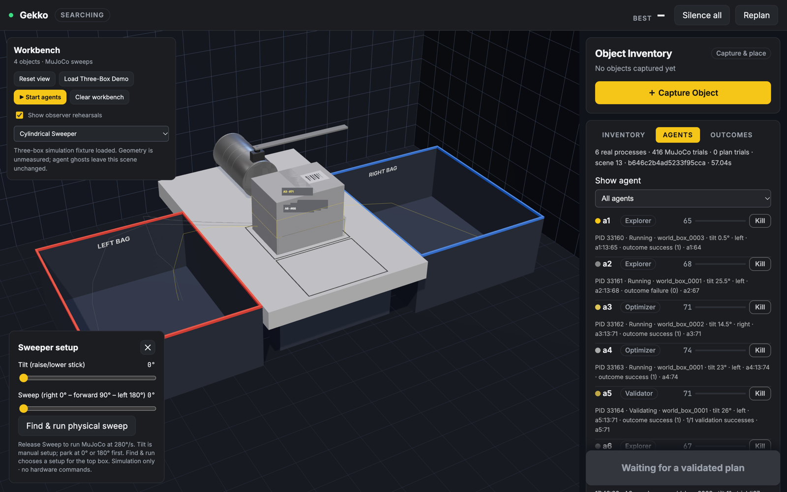
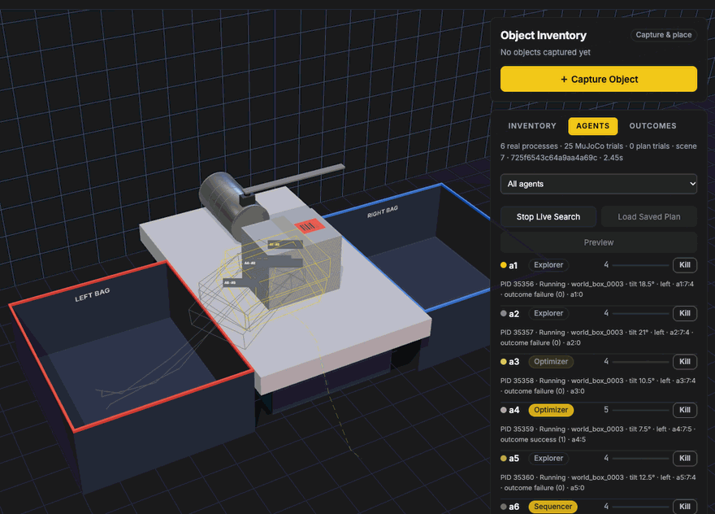

# Gekko — See it. Say it. Sort it.

**Winner — Best Project for Sustainability, RS track** · DurHack 2026

A swarm of independent agents rehearses every parcel sort in a MuJoCo physics simulation
before a real servo arm on an Arduino UNO Q moves. Kill agents mid-search and the
survivors still find a plan.



---

## What it does

Gekko sorts small parcels into a left or right bag by colour, using one servo with a
stick on it. Each push is planned and tested in simulation before anything moves.

1. **See it.** Photograph an object with the webcam, or upload a photo. Confirm what it
   is: a box, the sweeper or something else. It turns into a 3D model in the inventory.
2. **Place it.** Click inventory cards to build the scene on the workbench. Each box's
   colour decides its bag.
3. **Plan it.** Press **▶ Start agents**. Separate OS processes search for sweeps in
   MuJoCo and test the best ones under random changes in friction, mass and position.
   They share results peer to peer, with no coordinator.
4. **Break it.** Kill an agent. The others notice its missing heartbeats, take over its
   saved progress and keep going. The viewer shows each takeover as it happens.
5. **Say it.** When a full plan passes 80% of its randomised trials, **Say it** reads the
   sort order aloud.
6. **Sort it.** **Arm & Send to Arduino** sends the plan's left and right sweeps to the
   real servo on the UNO Q. A person sets the stick's tilt by hand.



*Live recording: yellow outlines are each agent's simulated pushes. Agent a1 is killed
partway through; the others detect it, take over its saved work and keep searching.*

## Results

### Fault tolerance

Measured by `scripts/swarm_reliability.py` on a MacBook, starting fresh processes for
every run. Full data in [`docs/swarm-reliability.json`](docs/swarm-reliability.json).

| Scenario | Agents | Validated plan | Time | MuJoCo trials |
|---|:-:|:-:|--:|--:|
| Normal run (seed 11) | 4 | ✅ | 54 s | 1,148 |
| Normal run (seed 29) | 4 | ✅ | 33 s | 776 |
| Kill the sequencer | 8 | ✅ | 94 s | 3,130 |
| Kill an explorer | 4 | ✅ | 47 s | 711 |
| Kill the only validator | 4 | ✅ | 67 s | 1,194 |
| Kill half the swarm | 8 | ✅ | 40 s | 1,110 |
| One survivor | 4 | ✅ | 129 s | 1,144 |
| One agent from the start | 1 | ✅ | 179 s | 1,473 |

**8 of 8 scenarios passed.** Each winning three-step plan was replayed against the fixed
test scene and every box ended in its assigned bag.

### Speed

After profiling, four agents find a validated three-box plan in about 19–25 s, down from
35 s. The physics, test scene and 80% threshold did not change. See
[`docs/demo-benchmark.json`](docs/demo-benchmark.json).

---

## Quick start

**Requirements:** Python 3.12 or newer, Node.js 20+ (tests only) and a browser with WebGL.
An Arduino UNO Q is optional.

```bash
git clone https://github.com/Sachin-1712/see-it-say-it-sort-it.git
cd see-it-say-it-sort-it
python3 -m venv .venv
.venv/bin/python -m pip install -r requirements-sim.txt
```

Run each of these in its own terminal, from the repository root:

```bash
python3 -m http.server 8080 --bind 127.0.0.1
```

```bash
.venv/bin/python -m swarm.server
```

```bash
.venv/bin/python -m sim.server
```

Open **<http://localhost:8080/viewer/>**.

| Process | Address | Purpose |
|---|---|---|
| Static file server | `http://localhost:8080` | Serves the viewer. There is no build step. |
| Swarm server | `ws://localhost:8765` | Starts the agents, streams their progress and talks to the UNO Q |
| Physics server | `ws://localhost:8766` | Runs single sweeps you make by hand on the workbench |

The swarm server starts 4 agents by default. Use `--workers N` to change that, or `--demo`
to start planning the three-box demo as soon as it launches.

### Saved plan (optional)

To replay or send a plan without waiting for a live search, validate one ahead of time:

```bash
.venv/bin/python -m scripts.prepare_demo --workers 4 --timeout 180
```

This runs the real agents and saves the plan to `.gekko/validated-three-box.json` only
if it passes the 80% threshold. Saved plans expire after 24 hours, and the viewer marks
them as **previously validated**, never as the live run.

### Viewer options

| Query parameter | Effect |
|---|---|
| `?observer=ws://host:port` | Connect to a swarm server at another address |
| `?physics=ws://host:port` | Connect to a physics server at another address |
| `?offline=1` | Use the bundled copy of three.js and system fonts. This turns on automatically when the browser has no network. |

---

## Demo walkthrough

1. Click **Load Three-Box Demo**, or capture and place your own boxes and the sweeper.
2. Press **▶ Start agents**. Outlined "ghost" boxes show each agent's simulated attempts;
   the solid scene does not change.
3. Open the **Agents** tab. Each row shows a real OS process ID, its current role and how
   many trials it has run. Press **Kill** on any agent and watch the recovery timeline
   show the heartbeat timeout, the takeover and the resumed work.
4. Press **Stop Live Search**, then **Load Saved Plan**. Use **Preview** or **Play
   sorting** to replay the stored MuJoCo trajectories, and **Say it** to hear the plan.
5. With the UNO Q connected, press **Arm & Send to Arduino** to run the sweeps on the real
   servo. **STOP** halts it. Disconnecting servo power is the immediate stop.

---

## How it works

```text
 Webcam / photo ──► Inventory ──► Workbench (three.js)
                                       │  scene snapshot
                                       ▼
                    ┌────────── Swarm server :8765 ──────────┐
                    │  starts processes, forwards telemetry  │
                    └───┬────────┬────────┬────────┬─────────┘
                        ▼        ▼        ▼        ▼
                      agent    agent    agent    agent      each one has its own
                        ▲        ▲        ▲        ▲        MuJoCo copy and seed
                        └─ UDP gossip: heartbeats, checkpoints ─┘
                                       │  validated plan (≥ 80% robust)
                                       ▼
                 Serial bridge ──► UNO Q firmware ──► servo (L / R / C)
```

Every agent can do all four jobs. Its role is simply what it is working on at the moment.

| Role | What it does |
|---|---|
| **Explorer** | Tries candidate sweeps in a random order, filtered by geometry |
| **Optimizer** | Adjusts the best sweeps so far, focusing on steps that failed |
| **Validator** | Re-runs a candidate under randomised friction (±20%), mass (±15%), position (±3 mm) and tilt (±1°) |
| **Sequencer** | Chains sweeps into a full plan and checks every box ends up in its bag |

**Fault tolerance.** Agents send a heartbeat every 500 ms, and each heartbeat carries a
small checkpoint of current work. If an agent goes quiet for 5 s, its peers claim its
work and resume from that checkpoint. The supervisor only starts processes and collects
telemetry. If it disappears, the agents keep searching.

**Hardware.** One process owns the serial port and locks it, so two programs can never
drive the servo at once. The UNO Q firmware accepts `L`, `R` and `C` (left, right and
centre) and replies when the move has finished. The device must be armed in the viewer
before every run.

---

## Project structure

```text
viewer/     three.js viewer: capture, inventory, workbench, agent overlay, playback
sim/        MuJoCo scene, sweep rollouts, scoring and the physics server
swarm/      agent processes, planning, UDP messaging, saved plans and serial playback
firmware/   UNO Q sketch for the servo
config/     rig geometry, scoring, swarm, UNO Q settings and the three-box test scene
assets/     GLB models for the box and the sweeper
scripts/    demo preparation, benchmarks, reliability runner, keyboard servo client
tests/      Node (viewer) and pytest (sim, swarm and playback) tests
docs/       design notes, protocols, review and measured reports
```

## Tests

```bash
npm ci --prefix tests && npm test --prefix tests
```

```bash
.venv/bin/python -m pytest -q tests
```

```bash
.venv/bin/python -m scripts.swarm_reliability --timeout 300 --output docs/swarm-reliability.json
```

---

## Documentation

| Document | Contents |
|---|---|
| [`docs/demo.md`](docs/demo.md) | Hackathon demo flow, saved plans and measured timings |
| [`docs/hardware-playback.md`](docs/hardware-playback.md) | UNO Q setup, calibration, serial bridge and safety rules |
| [`docs/swarm.md`](docs/swarm.md) | Swarm architecture, controls, reliability testing and limitations |
| [`docs/sim.md`](docs/sim.md) | MuJoCo simulation and its Python API |
| [`docs/sim-protocol.md`](docs/sim-protocol.md) | Physics server protocol |
| [`docs/viewer-frame.md`](docs/viewer-frame.md) | WebSocket frame format between the swarm and the viewer |
| [`docs/models.md`](docs/models.md) | Inventory, models and the workbench |
| [`docs/camera-inventory.md`](docs/camera-inventory.md) | Camera capture |
| [`docs/PRD.md`](docs/PRD.md) | Original hackathon plan (later requirements replace parts of it) |

## Built with

Python · [MuJoCo](https://mujoco.org) · NumPy · websockets · pyserial ·
[three.js](https://threejs.org) · plain ES modules (no build step) · Arduino UNO Q ·
Node test runner · pytest

## Team

Built at DurHack 2026 by **Sachin** (viewer and physics simulation) and **Joe** (agents,
observer and firmware).

## License

This repository does not include a license file yet. Contact the authors before reusing it.
